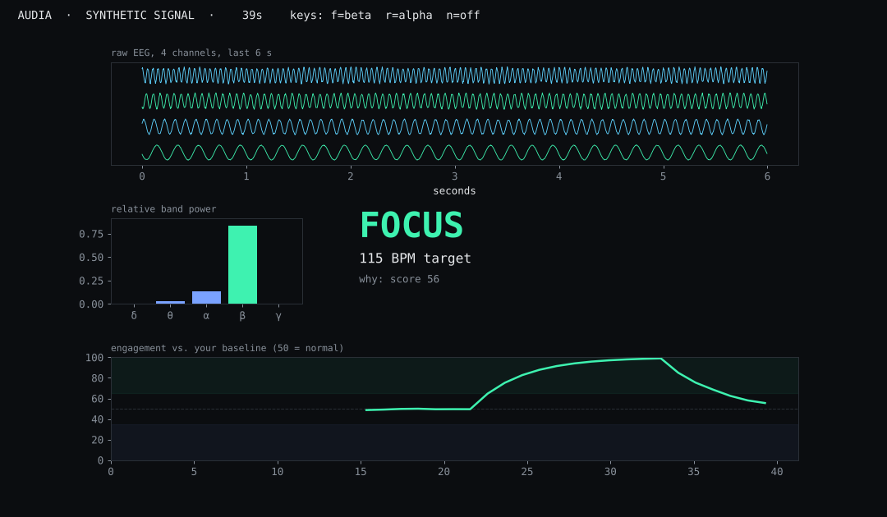

# Audia

A noninvasive BCI music companion. Concept stage. Phase 0: "It's alive."



Brain state in, music mode out. No headset needed yet.

BrainFlow's synthetic board streams 4 EEG channels. Every second, Audia:
1. takes the last 6 s of signal,
2. computes relative band power (delta, theta, alpha, beta, gamma),
3. computes an engagement index, `log(beta / (alpha + theta))` (Pope et al., 1995),
4. scores it 0 to 100 against your first 15 s (50 = your normal),
5. picks a mode (CALM 70 BPM, NEUTRAL 90, FOCUS 115) with hysteresis and an 8 s minimum dwell so it does not flip constantly.

## Run it (about 5 minutes)

```bash
python3 -m venv .venv && source .venv/bin/activate     # Windows: .venv\Scripts\activate
pip install -r requirements.txt
python audia_live.py                 # live dashboard
python audia_live.py --sound         # plus a synth whose tempo follows the mode
python audia_live.py --headless --script --seconds 65   # self-test in the terminal
```

In the dashboard, wait 15 s for calibration, then press:
- `f` to inject a 20 Hz beta wave: score climbs, mode goes FOCUS.
- `r` to inject a 10 Hz alpha wave: score drops, mode goes CALM.
- `n` to stop.

Injected waves are a **test harness**, labeled on screen. The synthetic board is not a brain.

## What is real and what is not
- Real: the pipeline, band powers, scoring, hysteresis controller, dashboard.
- Not real yet: any claim about a person's focus. That starts in Phase 2 with a Muse 2 (`--muse`) and labeled sessions.

## DIY hardware
I'm building the EEG front end myself. See [HARDWARE.md](HARDWARE.md) for the plan, the safety rules, and the gates each stage has to pass.
```bash
python audia_live.py --serial sim                    # simulated board over serial, no parts
python audia_live.py --serial /dev/cu.usbmodemXXXX   # my board
```

## Next
Phase 1: swap the synth for a local music folder analyzed with librosa (BPM, energy), and pick tracks by mode.
